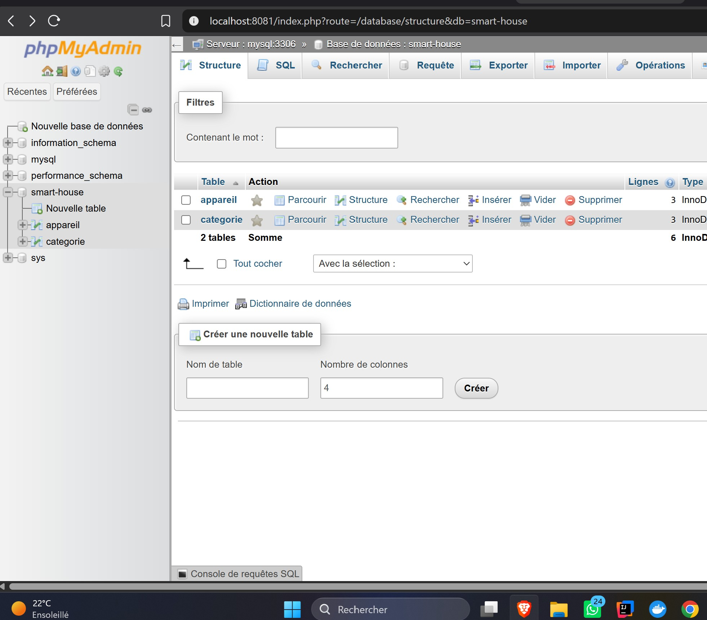
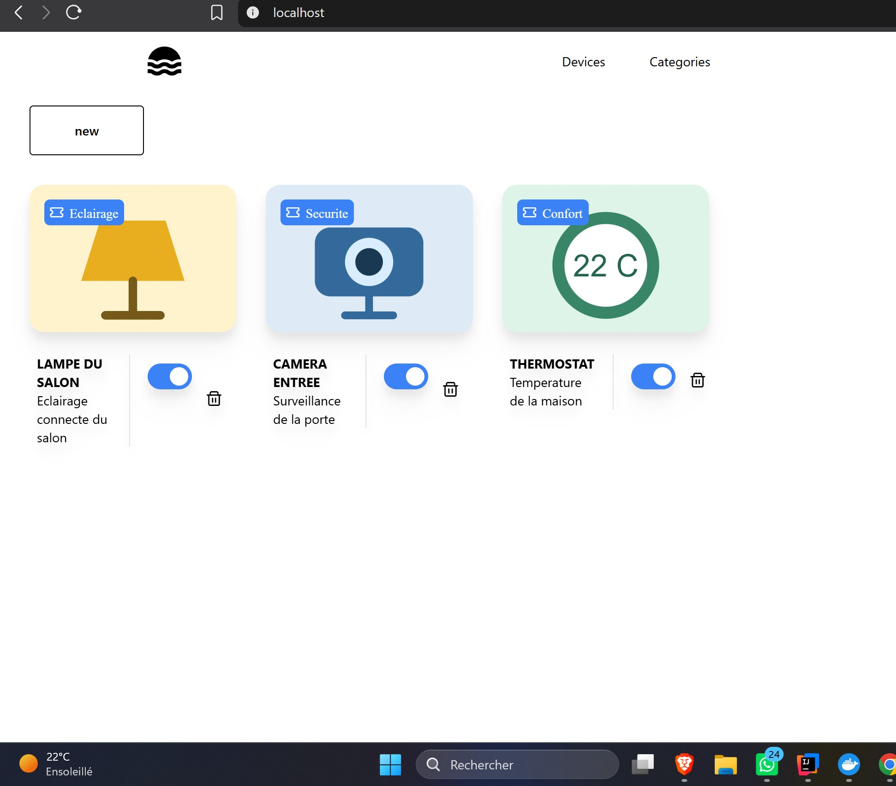
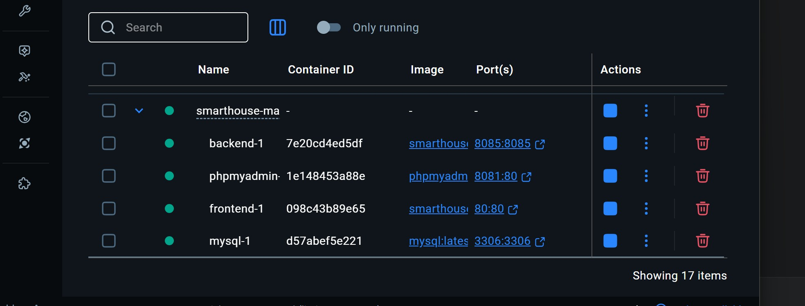

# TP24 — Smart Home avec Docker

Application de gestion d’une maison connectée avec Angular, Spring Boot et MySQL, déployée avec Docker Compose.

## Base de données

La base `smart-house` contient les tables `appareil` et `categorie`, visibles dans phpMyAdmin.

## Interface de l’application

L’interface affiche les appareils connectés et permet de gérer leur état.

## Conteneurs Docker

Les quatre services backend, frontend, MySQL et phpMyAdmin sont en cours d’exécution dans Docker Desktop.

